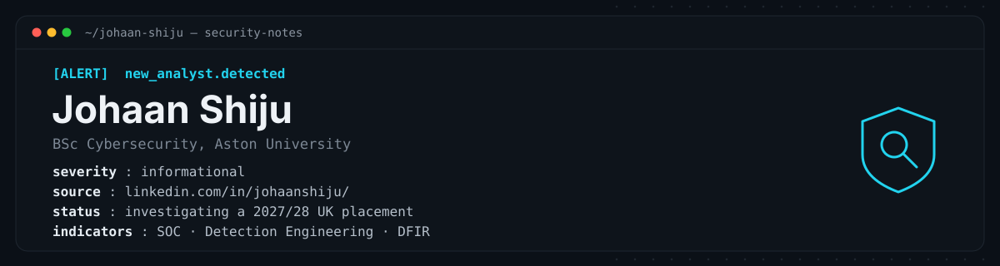

  

I'm a second-year BSc Cybersecurity student at Aston University looking for a 2027/28 placement. My public work so far leans towards detection and SOC investigation. I'm testing offensive security against it to see which side I'm actually better at.

  
  
  
  
  
  
  

## Selected work

| Work | What it shows | Stack |
| --- | --- | --- |
| [**Sigma Detection Rulepack**](https://github.com/JS4-14/Cybersecurity-Portfolio) | Rules for LSASS access (T1003.001) and mshta (T1218.005), converted to Splunk SPL. Two silent Sentinel/KQL conversion failures, found by hand-tracing real Sysmon events through the rule logic. | Sigma, Sysmon, SPL, KQL |
| [**SOC Investigation Repository**](https://github.com/JS4-14/Cybersecurity-Portfolio) | Four written investigations (phishing, malware, unusual login, PowerShell). IOCs mapped to ATT&CK, containment decisions, post-incident reflections. | ATT&CK, Windows logs |
| [**Home SOC Lab**](https://github.com/JS4-14/Cybersecurity-Portfolio) (in progress) | Three-VM Active Directory lab with Sysmon telemetry. Domain is live and a Kerberoasting ticket has been captured. Next: turn it into a detection. | VirtualBox, Windows Server, Sysmon |
| [**OverTheWire Bandit**](https://github.com/JS4-14/Cybersecurity-Portfolio) | Linux, Bash, SSH and privilege escalation, with a write-up per level. | Linux, Bash |
| **Aston x Warwick CTF** | Team event, 3rd place overall. Cryptography, file and metadata analysis, steganography. | CTF |

Right now I'm on the Kerberoasting detection stage of the Home SOC Lab.

## Contact

[LinkedIn](https://www.linkedin.com/in/johaanshiju/)
